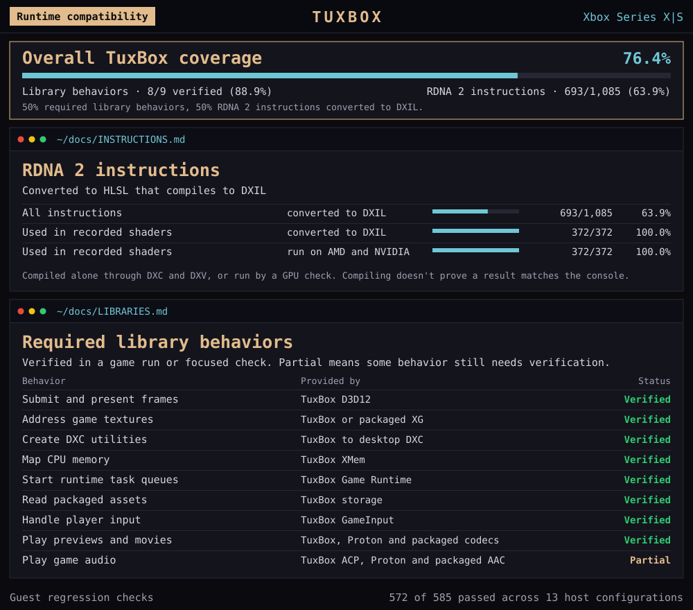

<p align="center">
  
</p>

<p align="center">
  <a href="docs/USAGE.md">Getting started</a> ·
  <a href="docs/PROGRESS.md">Progress</a> ·
  <a href="docs/ARCHITECTURE.md">Architecture</a> ·
  <a href="CONTRIBUTING.md">Contributing</a>
</p>

TuxBox is an experimental compatibility layer that aims to run Xbox Series X|S games on Linux and Windows PCs. It is Linux-first: Windows has a native Direct3D 12 backend, and game support there is still in development.

## `01 / how it works`

An Xbox Series game mostly calls the same APIs a Windows game does. Windows handles those itself, and Valve's Proton provides them on Linux. TuxBox supplies the part that is specific to the console:

- **Graphics:** the Xbox version of Direct3D 12, plus ray tracing and texture layouts.
- **Shaders:** a translator that turns the console's GPU code into shaders a PC graphics card can run.
- **Other libraries:** the memory, input, storage and audio calls a game actually uses.

We measure progress by what works in real games, not by how many functions exist. [Architecture](docs/ARCHITECTURE.md) · [Library coverage](docs/LIBRARIES.md)

## `02 / status`

TuxBox is early. No retail game is playable yet.

| Title | Where it gets to on Linux | Where it gets to on Windows |
| --- | --- | --- |
| **Lanes**, our own test game | Fully playable | Untested |
| **The Matrix Awakens** | Menu, the opening of the chase, and a free-roam city test, with visual faults and crashes | Untested |
| **GTA VI** | Renders the opening world scene at well under one frame a second, then a GPU fault | Untested |

Games are tested on an NVIDIA GeForce RTX 4070 Ti SUPER; the built-in checks have also passed on other NVIDIA and AMD cards. You supply your own games and system files. [Progress](docs/PROGRESS.md) · [Test results](docs/RESULTS.md)

[](docs/progress.svg)

<p align="center">
  
  <br><sub>The Matrix Awakens on TuxBox. Rendering faults and crashes remain.</sub>
</p>

## `03 / try lanes`

Install the [build tools](examples/lanes/README.md#build-requirements), then run from the project folder:

```sh
python -m pip install -r requirements.txt
python build.py lanes
python tuxbox.py run --app-id Lanes build/lanes
```

Press Left or Right to change lanes, or Space to take a turn in your current lane. R restarts and Escape quits.

## `04 / documentation`

- [Running games](docs/USAGE.md): shader preparation, logs, performance capture and offline launches
- [Launch options and environment variables](docs/ENVIRONMENT.md): settings and their defaults
- Game setup: [The Matrix Awakens](docs/MATRIX_AWAKENS.md) · [GTA VI](docs/PROJECTSCARLETT.md)
- [Shader coverage](docs/SHADERS.md) · [every RDNA 2 instruction](docs/INSTRUCTIONS.md)
- [Shader harness](docs/SHADER_HARNESS.md): test a translator change over recorded shaders and on each card
- [Where to improve](docs/FOCUS.md): open areas for contributors
- [Roadmap](docs/ROADMAP.md): the plan for shader translation and the project audit, as tasks to take
- [Source layout](docs/SOURCE_LAYOUT.md)
- [Credits and references](docs/REFERENCES.md)

## `05 / contributing`

Every change must pass the checks relevant to it, on a real GPU where it affects one. [How to contribute](CONTRIBUTING.md#test-what-your-change-touches)

## `06 / license`

Copyright © 2026 TuxBox contributors. TuxBox is licensed under the [Apache License 2.0](LICENSE). Third-party materials retain their own terms. [Third-party notices](docs/REFERENCES.md#shader-compiler-attribution) · BCPack decoding is based on [bcpack-rs](https://github.com/Ahmet-Dedeler/bcpack-rs) by Ahmet Dedeler and Microsoft's [silicon-rans](https://github.com/microsoft/silicon-rans). [Storage codec notices](docs/REFERENCES.md#storage-codec-attribution)
